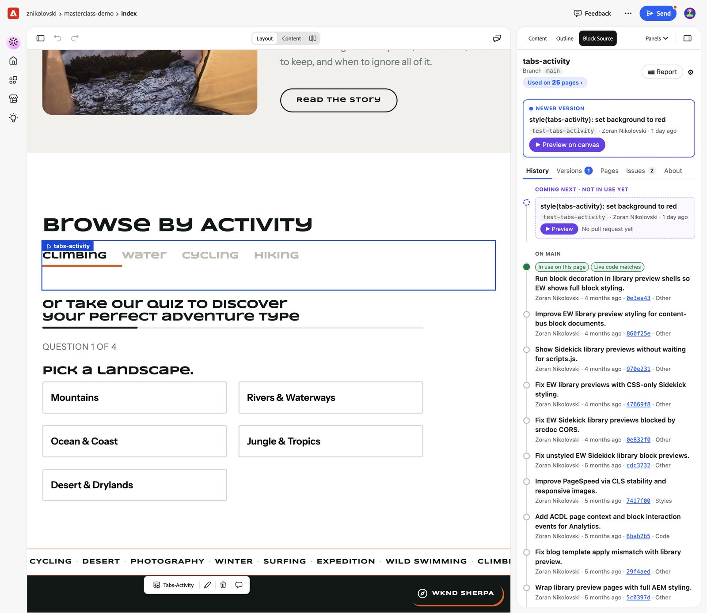
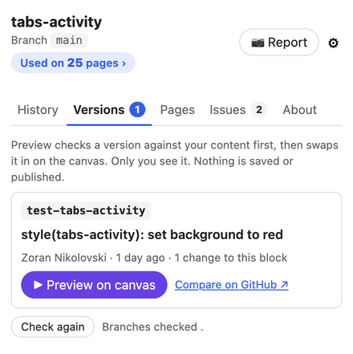
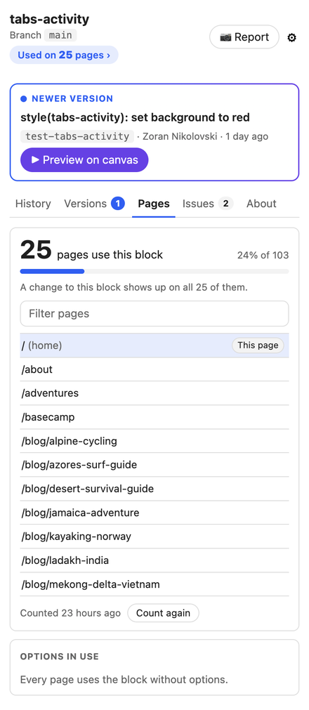
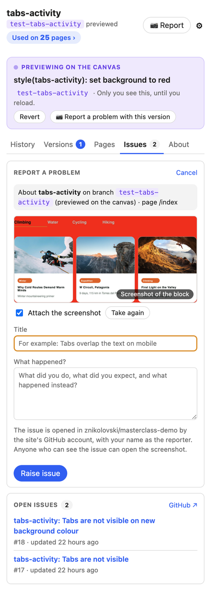
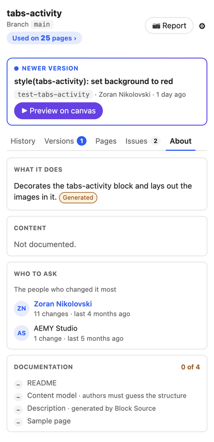
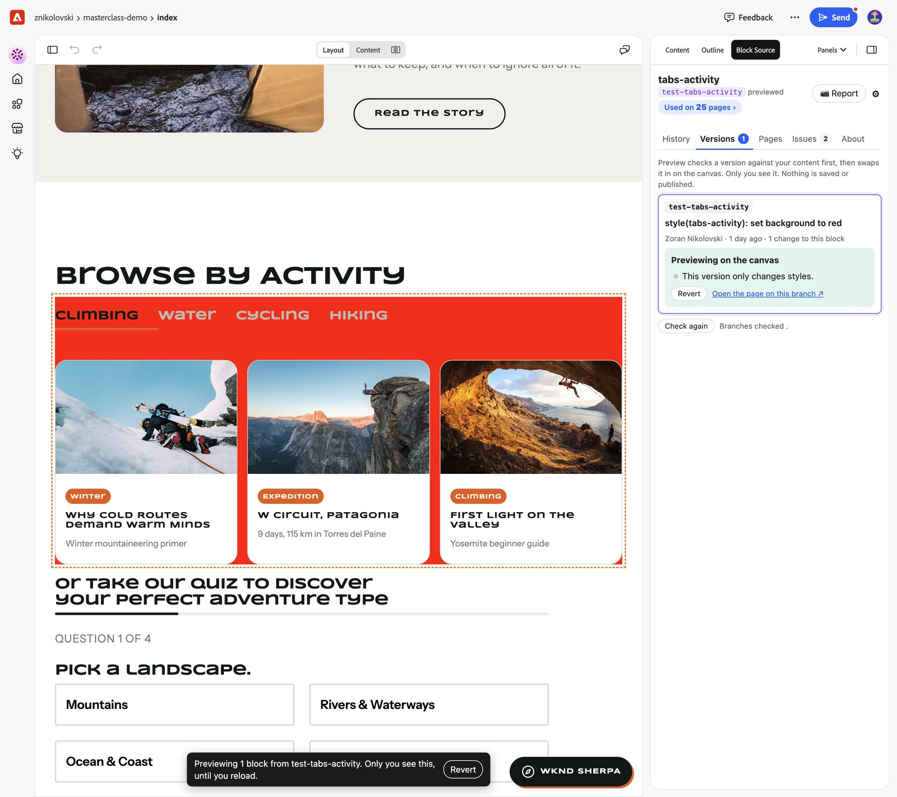

# Block Source

Block Source is a panel for [Experience Workspace](https://da.live) (DA) that tells authors about the block they are working on. Select a block in the document and the panel shows where its code came from, whether there is a newer version, how it is used across the site, and lets the author report a problem with it, without leaving the editor or asking a developer.



## What authors can do

- **See what matters at once.** The header names the block and the branch in use, shows **Used on N pages**, and has a **📷 Report** button. When a branch has a newer version, a callout offers **Preview on canvas** in one click.
- **History.** A timeline of the block's changes: newer versions on other branches ("Coming next") first, then the commits on the page's branch, with who made them, when, and which one the page uses now.
- **Versions.** Branches where developers have a newer version of the block. **Preview on canvas** first checks the new version against the author's own content:
  - **Works with your content**: the block on the canvas is swapped for the new version, for this session only. Nothing is saved or published, and **Revert** or a reload puts it back.
  - **Does not fit**: with the reasons and who to ask.
  - **Could not confirm**: the author can still open the whole page on that branch.
- **Pages.** How many pages use the block and what share of the site that is, the list of pages (this page first) and which of the block's options are used.
- **Issues.** Open GitHub issues about the block, and **Report a problem**: raise an issue against the branch the author is looking at (including a previewed version), with the page, the author's description and a screenshot of the block from the canvas, so developers get everything they need.
- **About.** What the block does, what content it expects with a link to a sample page, who to ask, and how well it is documented.

| Versions | Pages | Report a problem | About |
| --- | --- | --- | --- |
|  |  |  |  |

**Preview on canvas** swaps the newer version into the page for the author only. Here the `test-tabs-activity` branch gives the block a red background:



Block Source only reads the site's code. The one thing it writes is the issue an author chooses to raise.

## Requirements

- A DA site whose code is in a GitHub repository.
- Page previews on `aem.page` that do not require sign-in.
- A site administrator: someone who can edit the site's configuration in DA. Setup takes about ten minutes and is done once per site.

## Set up

### 1. Add the panel to Experience Workspace

1. Open the site configuration: `https://da.live/config#/{org}/{site}` (for example `https://da.live/config#/acme/website`).
2. Open the **library** sheet, or add a sheet named `library` if there is none.
3. Add a row:

   | title | path |
   | --- | --- |
   | Block Source | `https://28538-blocksource.adobeio-static.net/block-source.html` |

4. Save the configuration.

Authors now see **Block Source** in the panel list in Experience Workspace (reload the editor if it is already open).

Block Source assumes the site's code is in the GitHub repository `{org}/{site}`, matching the DA URL. If it is somewhere else, add these keys to the same configuration, in any sheet with `key` and `value` columns (such as `data`):

| key | value |
| --- | --- |
| `github.owner` | The GitHub user or organization that owns the repository. |
| `github.repo` | The repository name. |

Other optional keys, in the same kind of sheet:

| key | value |
| --- | --- |
| `blocksource.protected` | Branches never offered to authors, comma-separated, with `*` wildcards. For example `release-*, hotfix-*`. |
| `blocksource.default-branch` | The branch pages use. Defaults to the repository's default branch. |
| `blocksource.external` | Blocks whose code lives in another repository, as `name=owner/repo`, comma-separated. Block Source names their source and does not show history or versions for them. |

### 2. Connect GitHub with a token

Block Source reads the site's code with a GitHub token that a site administrator adds once for the site. The token is never typed into the configuration sheet. It goes into the panel's own settings, where it is stored encrypted and can only be used for this site.

**Create the token**

1. Sign in to GitHub as a machine user (for example `svc-blocksource`) rather than a person, so the token does not depend on someone's account. The account needs access to the site's repository; give it **Triage** access or higher if you want raised issues to be labelled.
2. In Experience Workspace, open **Block Source**, click the gear, and follow **Create a fine-grained token on GitHub**. The link opens GitHub's token page with the name, description and permissions filled in. Check them:
   - **Resource owner**: the owner of the site's repository.
   - **Repository access**: **Only select repositories**, and select only the site's repository.
   - **Permissions** (repository):

     | Permission | Access | Needed for |
     | --- | --- | --- |
     | Contents | Read-only | Required. Reading the block code, history and branches. |
     | Metadata | Read-only | Required (GitHub adds it automatically). |
     | Pull requests | Read-only | Optional. Pull request links in History and Versions. |
     | Issues | Read and write | Optional. Read shows open issues in the Issues tab; write lets authors use **Report a problem**. |
     | Commit statuses, Checks | Read-only | Optional. Build status of a branch. |

   - **Expiration**: as your security policy allows. Block Source shows the expiry date and warns before the token expires.
3. Generate the token and copy it. If the repository belongs to an organization that requires approval for fine-grained tokens, an organization owner must approve it first.

A classic token with the `repo` scope also works, but a fine-grained token limited to one repository is safer.

**Add it to Block Source**

1. In the Block Source settings (the gear), paste the token and click **Save and test**.
2. Block Source checks the token before saving it: that it is valid, that it gives access to the site's repository (a token for the wrong repository is rejected), and which of the optional permissions it has. A token that fails the check never replaces a working one.

After saving, administrators see the last four characters of the token, its expiry, its permissions and its remaining rate limit. To rotate the token, paste a new one in the same place. To disconnect GitHub, click **Remove token**. If you change a token's permissions on GitHub, click **Check again**.

### 3. Let Block Source reach the canvas (for Preview on canvas)

To swap a block on the canvas and to take screenshots for issues, Block Source needs a small script running in the page on the canvas. Add this line to the site's `scripts/scripts.js`, outside any function (the end of the file is fine), and commit it to the `main` branch:

```js
if (window.top !== window) import('https://28538-blocksource.adobeio-static.net/agent.js').catch(() => {});
```

The script loads only when the page is shown inside a frame, such as the Experience Workspace canvas, so site visitors never load it. It acts only on requests from the Block Source panel in the same browser tab, and only for this site. It changes the page only while an author is previewing a block, and only until they revert or reload.

**Without this line**, everything else in Block Source still works:

- **Versions** still checks a newer version against the author's content. Instead of previewing it on the canvas, the author uses **Open the page on this branch**. That opens the page in a new tab on the branch's preview site (`https://{branch}--{site}--{org}.aem.page/{page}`), showing the whole page with all of that branch's code and the last previewed content, not unsaved edits.
- **Report a problem** still raises the issue, without a screenshot.

## Help authors understand your blocks (optional)

The About tab and its documentation score read these files from each block's folder when they exist. Without them, Block Source describes the block from its code and content model.

- `blocks/{name}/README.md`: the first paragraph describes the block, and the first table describes its content. Add a `## Variants` list and a line like `Sample: /drafts/samples/cards` for the sample page.
- Or a comment at the top of `blocks/{name}/{name}.js`:

  ```js
  /**
   * Cards with an image and text.
   * @content image | text
   * @variants featured, dark
   * @sample /drafts/samples/cards
   */
  ```

- Universal Editor models (`_{name}.json`, `component-models.json`) give the field-level content checks.
- `CODEOWNERS` entries for `blocks/{name}/` tell authors who to ask. Without them, Block Source names the people who changed the block most.

## Good to know

- **Who can do what.** Anyone who can open the site in DA can use the panel. Only users who can edit the site configuration can add or remove the token and start a usage count.
- **Page counts** come from a scan of the site's DA content, refreshed nightly or by an administrator with **Count again**. Pages under `/blocks`, `/library`, `/templates`, `/drafts` and `/tools` are not counted.
- **Issues** are posted by the token's GitHub account, with the author's display name in the issue (no email address) and the label `block:{name}`. Screenshot links are hard to guess but public: anyone who can see the issue can open the screenshot. Authors can raise up to 5 issues every 10 minutes.
- **Which branches are offered.** Only branches in the site's repository with changes to the block and activity in the last 90 days, excluding protected branches. New branches appear within about a minute; **Check again** in Versions looks again right away.
- **Previews are for the author only** and last until they revert or reload. Using a newer version for real still means a developer merging the branch.

## For maintainers

How Block Source works, how to run your own deployment and how to develop it: [docs/DEVELOPMENT.md](docs/DEVELOPMENT.md).
